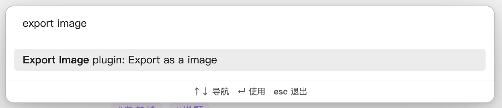
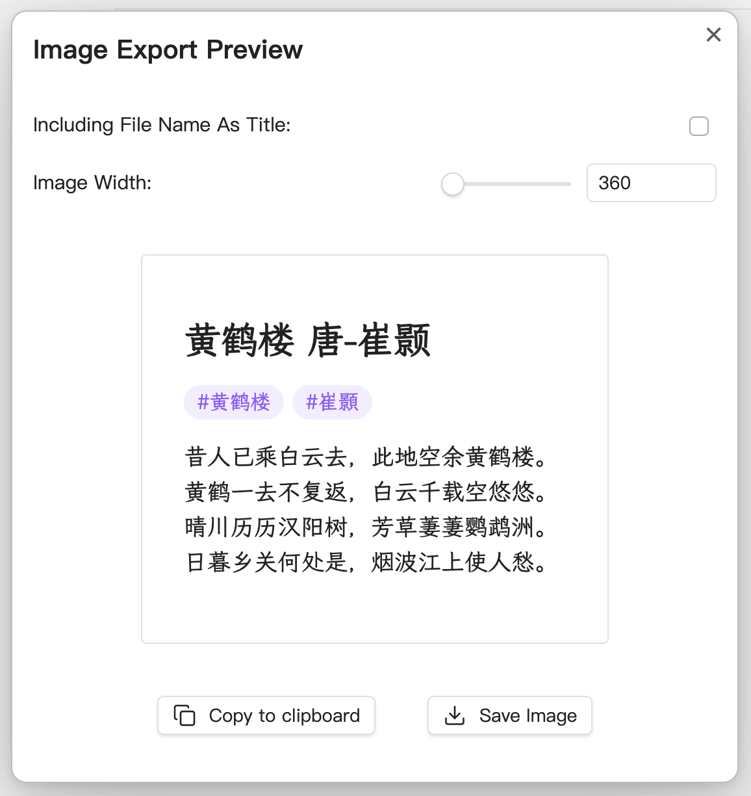
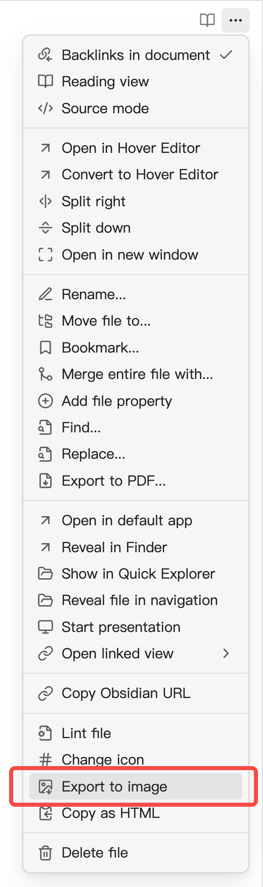

# 「binshao」Export Image

> 这是 [zhouhua/obsidian-export-image](https://github.com/zhouhua/obsidian-export-image) 的 fork，面向 Obsidian 1.15+（Pele）重写了导出管线，并补了设置持久化、移动端 canvas/相册路径、图片原图与字体按需内嵌。
>
> 原项目 MIT，Copyright (c) 2024 Zhou Hua；本 fork 的修改 Copyright (c) 2026 binshao。原项目与本 fork 无隶属关系，完整归属声明见 [NOTICE](./NOTICE)。

This Obsidian plugin can easily help you export any article as an image.

## Fork changes

- 导出改为在导出宽度下用 `MarkdownRenderer` 重新渲染，不再抓编辑器 DOM。
- 适配 Obsidian 1.15+ 的 Pele：按导出宽度重挂载、移除 `.pele-zoom`、等字体稳定。
- 字体按实际使用情况内嵌；桌面端本地字体可用时跳过 base64。
- 内嵌图片读取 vault 原图，避免 2x/3x 放大显示分辨率图。
- split/PDF 单次栅格化后裁页；移动端按 canvas 面积预算自动降 scale。
- 导出弹窗设置持久化；头像/名称（含备注）垂直居中。
- 默认边距 20px。


## Features

-  Export any article as an image, with the option to save it as a local image file or copy it to the clipboard.
-  Support adding watermarks, both text and image watermarks, to protect your copyrights.
-  Support adding author information (avatar, name, etc.) for easier sharing and dissemination.
-  Support outputting images at twice the resolution for clearer display on high PPI devices like smartphones.
-  Support adjusting the image width to cater to different scenarios, such as exporting images suitable for viewing on mobile devices or ensuring readability when embedding images in articles.
-  Offer flexible configuration options with a convenient WYSIWYG (What You See Is What You Get) interface.
-  Support exporting selected content as an image.
-  Support for batch exporting all notes in a folder as images.
-  Support displaying obsidian [metadata](https://help.obsidian.md/Editing+and+formatting/Properties).
-  Support split long articles into multiple images.

## Usage

Use the command `export as a image` in command palette (Press cmd/ctrl+P to enter the command) to generate a image. You can download it to your file system, or copy to clipboard.





Also, you can access this function from the editor menu:



> [!NOTE]
> Due to device limitations, exporting images on mobile can only be saved to the current vault.

## Installation

### Obsidian

Search `Export Image` in community plugins.

## Custom Styles

To help experienced users write their own CSS styles, here is the combined DOM structure of the exported image.

```html
<!-- Export Image Root -->
<div class="export-image-root markdown-reading-view">
  <!-- Watermark Container -->
  <div class="markdown-preview-view markdown-rendered export-image-preview-container">
    <!-- Inline Title -->
    <div class="inline-title"></div>
    <!-- Metadata -->
    <div class="metadata-container">
      <div class="metadata-content">
        <!-- Metadata Items -->
        <div class="metadata-property">
          <!-- Metadata Key -->
          <div class="metadata-property-key">
            <!-- Metadata Icon -->
            <span class="metadata-property-icon"></span>
            <!-- Metadata Name -->
            <span class="metadata-property-name"></span>
          </div>
          <!-- Metadata Value -->
          <div class="metadata-property-value"></div>
        </div>
      </div>
    </div>
    
    <!-- Note Content -->
    <div>...</div>
  </div>
  
  <!-- Author Info -->
  <div class="user-info-container">
    <!-- Author Avatar -->
    <div class="user-info-avatar"></div>
    <div>
      <!-- Author Name -->
      <div class="user-info-name"></div>
      <!-- Extra Info -->
      <div class="user-info-remark"></div>
    </div>
  </div>
</div>
```

## Star History

<a href="https://star-history.com/#zhouhua/obsidian-export-image&Date">
 <picture>
   <source media="(prefers-color-scheme: dark)" srcset="https://api.star-history.com/svg?repos=zhouhua/obsidian-export-image&type=Date&theme=dark" />
   <source media="(prefers-color-scheme: light)" srcset="https://api.star-history.com/svg?repos=zhouhua/obsidian-export-image&type=Date" />
   
 </picture>
</a>

## Special Thanks

- [dom-to-image](https://github.com/tsayen/dom-to-image) & [dom-to-image-more](https://github.com/1904labs/dom-to-image-more). This repo borrows lots of code from [dom-to-image-more](https://github.com/1904labs/dom-to-image-more). The amazing lib helps me generate images from dom.

## My Other Obsidian Plugins

- [Markdown Media Card](https://github.com/zhouhua/obsidian-markdown-media-card)
- [vConsole](https://github.com/zhouhua/obsidian-vconsole)
- [POWER MODE](https://github.com/zhouhua/obsidian-power-mode)
- [Another Sticky Headings](https://github.com/zhouhua/obsidian-sticky-headings)
- [PopKit](https://github.com/zhouhua/obsidian-popkit)
